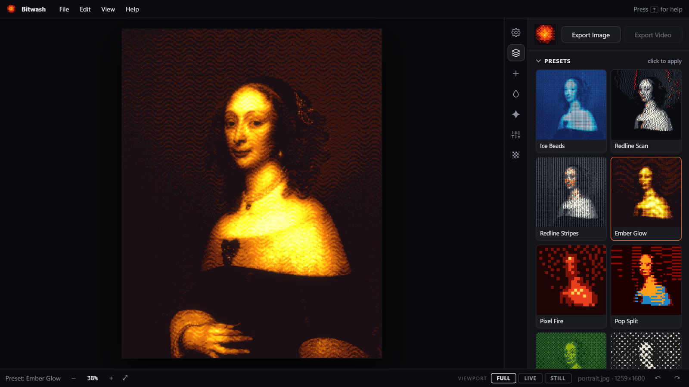
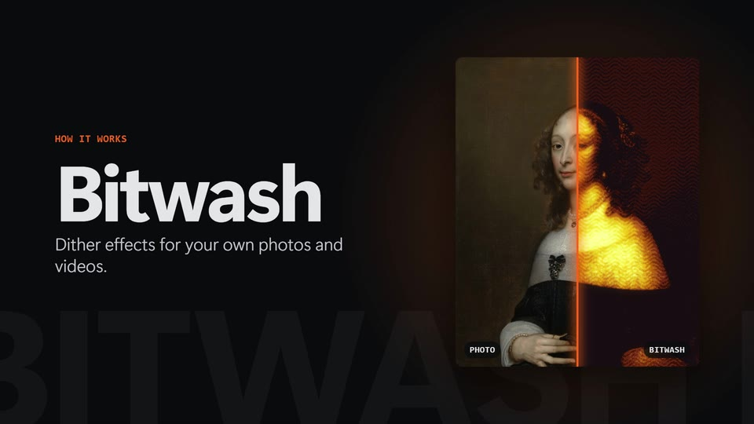
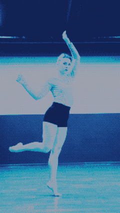
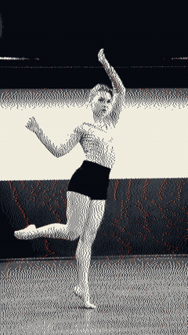
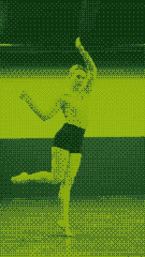
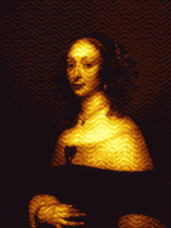
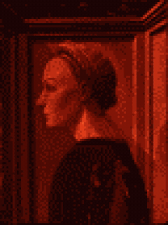
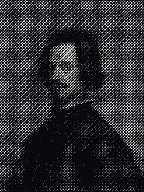

# Bitwash

Dither effects for photos and videos: 22 dither algorithms, palettes with editable colours, image adjustments, the
**Halo Glow** and live preset thumbnails. It exports PNG stills and MP4 videos with the original sound.

**Everything runs on your computer. No account, no API key, nothing is uploaded.** The app needs no Python packages:
only Python itself, plus ffmpeg for videos.

Inspired by Studio AAA's *Dither Boy*, shown in a [reel by Studio AAA](https://www.instagram.com/reel/Dd60gkJAYAX/).
Bitwash is an independent project, not affiliated with Studio AAA, and shares no code with it.



<!-- videos:start -->
## See it in action

<p align="center"><a href="docs/videos/tutorial.mp4"></a><br><b>▶ <a href="docs/videos/tutorial.mp4">How it works</a></b> (0:55, with captions)</p>

**Made with Bitwash, from public-domain portraits (The Met) and a free Pexels clip**

<table><tr>
<td width="33%" align="center"><a href="docs/videos/examples/dancer-ice-beads.mp4"></a><br><a href="docs/videos/examples/dancer-ice-beads.mp4">Ice Beads</a></td>
<td width="33%" align="center"><a href="docs/videos/examples/dancer-redline-scan.mp4"></a><br><a href="docs/videos/examples/dancer-redline-scan.mp4">Redline Scan</a></td>
<td width="33%" align="center"><a href="docs/videos/examples/dancer-pocket-green.mp4"></a><br><a href="docs/videos/examples/dancer-pocket-green.mp4">Pocket Green</a></td>
</tr><tr>
<td width="33%" align="center"><a href="docs/videos/examples/portrait-ember-glow.mp4"></a><br><a href="docs/videos/examples/portrait-ember-glow.mp4">Ember Glow (photo)</a></td>
<td width="33%" align="center"><a href="docs/videos/examples/portrait-pixel-fire-cycling.mp4"></a><br><a href="docs/videos/examples/portrait-pixel-fire-cycling.mp4">Pixel Fire + Color Cycling</a></td>
<td width="33%" align="center"><a href="docs/videos/examples/portrait-ink-crosshatch.mp4"></a><br><a href="docs/videos/examples/portrait-ink-crosshatch.mp4">Ink Crosshatch</a></td>
</tr></table>

Click any picture to play the video. The portrait examples are a slow zoom on the photo, exported as video. Example sources: *Portrait of a Woman* by Adriaen Hanneman, [The Met](https://www.metmuseum.org/art/collection/search/436630); *Portrait of a Man* by Velázquez, [The Met](https://www.metmuseum.org/art/collection/search/437874); *Portrait of a Woman* by Giovanni di Francesco, [The Met](https://www.metmuseum.org/art/collection/search/437859) (all CC0); "A Woman Dancing Gracefully" by [Pavel Danilyuk](https://www.pexels.com/video/a-woman-dancing-gracefully-6939968/) (Pexels licence).
<!-- videos:end -->

## Install

You need:
- Windows 10 or 11 (it is built and tested on Windows 11)
- [Python](https://www.python.org/downloads/) 3.11 or newer
- [ffmpeg](https://ffmpeg.org/download.html) on your PATH (ffmpeg and ffprobe), for MP4 export and for videos Chrome
  can't play
- Google Chrome or Microsoft Edge (WebGL2): the app opens in its own window

```
python launch.pyw
```

The launcher starts a local server on `127.0.0.1:48217` (if it isn't running yet) and opens the app window. The server
quits about 2½ minutes after the window closes, never while an export is running. Set `BITWASH_PORT` to use another
port.

Optional: `powershell -ExecutionPolicy Bypass -File make_shortcut.ps1` puts a **Bitwash** shortcut on your Desktop.

## How it works

```
source (photo / video frame)
  └─ scaled down to the grid (one cell = Scale source pixels)
       └─ core.js: Adjustments → dither into palette tones → colourise (+ color cycling)
            └─ render.js (GPU): each cell drawn as a shape → Halo Glow (halo + haze) → screen / export
```

1. **Open** a photo (JPG, PNG, WEBP) or a video (MP4, MOV, WEBM), or drop or paste it anywhere. **Try a Sample**
   opens the three public-domain portraits in turn.
2. The panel on the right has five sections:
   - **Dither**: the algorithm (Threshold; Bayer 2×2 to 16×16, Blue Noise, White Noise; Halftone Dots, Horizontal,
     Vertical, Diagonal and Wave Lines, Crosshatch; Floyd-Steinberg, Atkinson, Jarvis-Judice-Ninke, Stucki, Burkes,
     Sierra, Sierra Lite; Scanline and Column Streaks), the **Pixel Shape** (square, dot, bead, horizontal or
     vertical line), Scale, Luminance, Line Scale, Smoothing and Bleed.
   - **Color Palette**: categories (Cyberpunk, Retro, Glow, Print, Mono, Source, Custom), the colour list with hex
     codes, **+ Add Color**, **Import Palette**, Color Cycling and Color Depth. *Source* samples the picture's own
     colours.
   - **Adjustments**: Brightness, Contrast, Saturation, Midtones, Highlights, Hue, Blur and Denoise.
   - **Halo Glow**: a bright pass (Threshold ± Threshold Smoothing), then two blurs: a tight halo around each dot
     and a wide haze. Both use the kernel `1 / (Falloff + (d · Distance Scale)²)`, stretched along *Direction* by
     *Aspect Ratio*. *Scale with Image* scales the radius with the image size, so the preview matches a 4× export.
   - **Presets**: 12 built-in looks (Ice Beads, Redline Scan, Redline Stripes, Ember Glow, Pixel Fire, Pop Split,
     Pocket Green, Newsprint, Riso Pop, Green Terminal, Synth Dots, Ink Crosshatch). Each thumbnail shows the look on
     your own picture. **Save Current Look…** adds your own.
3. **Mapping.** *Luminance* is a gradient map: brightness picks a tone along the palette, sorted dark to light.
   *Nearest Colour* gives each pixel its closest palette colour (use it with Source palettes).
4. **Viewport.** FULL renders the exact grid and plays motion. LIVE caps the grid at about 220k cells, so video and
   colour cycling stay smooth. STILL pauses on one frame at full quality. While a slider is dragged in FULL, the
   preview uses the LIVE cap and snaps to exact on release.
5. **Export**: PNG for photos and single frames, MP4 for videos, at 1× to 4× the source size. **Keep the video's
   sound** copies the source's audio into the MP4.
   - ffmpeg decodes the source **in order**, already at grid size: exact frames, with no slow seeking on phone
     clips. The window dithers and renders each frame and streams it back, and ffmpeg encodes H.264 with the
     source's sound.
   - Videos Chrome can't play (HEVC, ProRes…) are converted to an H.264 copy when opened.
   - Files go to `Pictures\Bitwash` in your user folder. Set the `BITWASH_OUT` environment variable to use another
     folder. Existing files are never overwritten: a second export gets " (2)".

### Shortcuts

`Ctrl O` open · `Ctrl S` export PNG · `Ctrl Shift S` export MP4 · `Ctrl Z / Ctrl Y` undo / redo ·
`Q W E` Full / Live / Still · `Space` play / pause · hold `\` to see the original · `+ − 1 F` zoom ·
`X` random look · `?` help. Double-click a slider's name to reset it. Drop or paste images, videos or palette
files (`.gpl`, `.hex`, `.txt`, `.json`, `.css`, or an image to sample) anywhere.

## What's where

```
bitwash/
├─ server.py            local server (Python standard library only): serves static/, saves PNGs, keeps opened
│                       videos for their sound, decodes video frames in order for exports (ffmpeg), and
│                       muxes the window's frames + source audio into MP4 (ffmpeg)
├─ launch.pyw           launcher: starts the server, opens the Chrome or Edge app window
├─ make_icon.py         draws icon.png / icon.ico / static/icon.png (the dithered sun mark; needs Pillow)
├─ make_shortcut.ps1    creates the Desktop shortcut
├─ package.json         lets Node run the engine tests (no dependencies)
├─ static/              the app (plain ES modules, no build step)
│  ├─ index.html        layout: menu bar, viewport, icon rail, right panel, status bar
│  ├─ style.css         dark theme
│  ├─ core.js           the engine: adjustments, tones, 22 dithers, color cycling, palette extraction/parsing
│  ├─ render.js         WebGL2: draws cells as square/dot/bead/line/diamond, then the Halo Glow
│  ├─ palettes.js       palette library (Cyberpunk, Retro, Glow, Print, Mono, Source, Custom)
│  ├─ presets.js        the 12 built-in looks
│  └─ app.js            UI, render loop, viewport modes, undo/redo, presets, palette import, exports
├─ samples/             three public-domain portraits (CC0, see samples/CREDITS.md) for "Try a Sample"
└─ tests/
   ├─ core.test.mjs     engine tests
   └─ test_server.py    server tests
```

Your data lives in `%LOCALAPPDATA%\Bitwash\`: `presets.json` (your saved looks and palettes), `sources\` (copies of
opened videos, pruned after 24 h), `server.log`, `app.log`, `ffmpeg-export.log`, and the app window's browser
profile. Set `BITWASH_DATA` to use another folder.

## Tests

```
node --test tests/core.test.mjs
python -m unittest discover -s tests
```

- The 19 engine tests check that every algorithm reproduces greys and ramps, the screens are tone-equalised, the
  streak kernels can't flood (a regression test from a real bug), palettes parse, and the speed is fine for live
  video.
- The 13 server tests check that no path escapes, no file is overwritten, range seeking works, the port is bound
  exclusively, MP4 export works with sound and odd sizes, cancel cleans up, and they cover the ProRes proxy, the
  throttling opt-out and keep-alive with unread bodies. The video tests need ffmpeg on your PATH.

## Windows notes

- The server binds its port exclusively. Python's default `SO_REUSEADDR` lets a second app silently share a port on
  Windows.
- It opts itself and its ffmpeg children out of Windows power throttling, which otherwise slows windowless
  processes 8–10× (a video export dropped to about 2 frames a second).
- It speaks HTTP/1.1 keep-alive. With HTTP/1.0, the two requests per video frame each opened a new connection, and
  Chrome began failing at random after a few hundred.

## Credits

- Inspiration: Studio AAA's *Dither Boy*, shown in a [reel by Studio AAA](https://www.instagram.com/reel/Dd60gkJAYAX/).
  Bitwash is an independent project, not affiliated with Studio AAA, and shares no code with it.
- Sample images: three portraits from [The Metropolitan Museum of Art](https://www.metmuseum.org/) Open Access
  program (CC0). See [samples/CREDITS.md](samples/CREDITS.md).
- Footage in the tutorial and examples: the three sample portraits above (CC0), and "A Woman Dancing
  Gracefully" by [Pavel Danilyuk](https://www.pexels.com/video/a-woman-dancing-gracefully-6939968/) ([Pexels licence](https://www.pexels.com/license/)).

## Licence

MIT, see [LICENSE](LICENSE).
